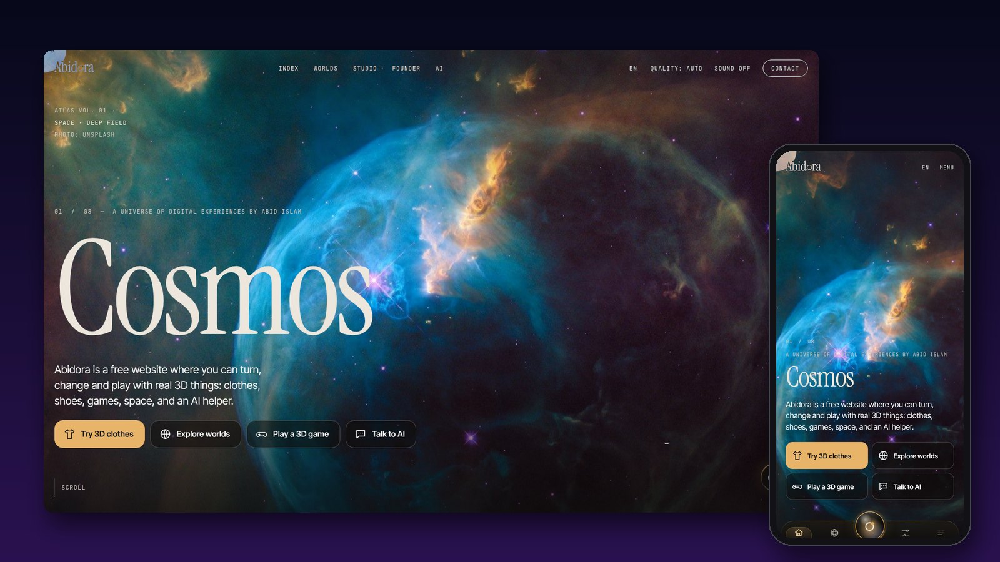

<p align="center">
  
</p>

<h1 align="center">ABIDORA</h1>

<p align="center">
  <b>A Universe Without Limits.</b><br>
  An immersive web platform of interactive 3D worlds, a world studio and Abidora AI, in 10 languages.
</p>

<p align="center">
  <a href="https://abidora.boostnixmedia.com/"><b>🌐 Website</b></a> &nbsp;·&nbsp;
  <a href="https://abid2929.github.io/ABID-ORA/"><b>👀 GitHub preview</b></a> &nbsp;·&nbsp;
  <a href="project-docs/"><b>📚 Project docs</b></a>
</p>

<p align="center">
  <kbd>Astro</kbd> <kbd>TypeScript</kbd> <kbd>Three.js</kbd> <kbd>GSAP</kbd> <kbd>Lenis</kbd> <kbd>cannon-es</kbd> <kbd>PHP 8</kbd> <kbd>MySQL</kbd> <kbd>Google Gemini</kbd> <kbd>i18n</kbd>
</p>

---

## ✨ Highlights

- **3D worlds:** fashion, watches, racing, space, oceans, technology and more, each one interactive.
- **World studio:** change and play with real 3D models in the browser.
- **Abidora AI:** an assistant with chat and voice.
- **10 languages:** English, Bangla, Spanish, French, German, Arabic (RTL), Chinese, Japanese, Korean and Hindi.
- **Phone-first:** app-style tab bar on phones, quality settings (Auto / High / Low) for slower devices.
- **Admin and installer:** web installer, admin panel, messages and branded emails.

Version **0.9.20** (22 Nov 2026).

## 🛠️ Stack

- **Astro + TypeScript** builds the static page templates and bundles the JS and CSS.
- **Three.js, GSAP, Lenis and cannon-es** handle 3D, motion and physics.
- **PHP 8** runs the API, admin panel, AI proxy and the 10-language page renderer (`tools/publish.php`, `public/_abidora/lib/`).
- **MySQL** (optional) and JSON translation files (`public/_abidora/i18n/*.json`).

## 📁 Project structure

| Folder | What it holds |
|---|---|
| `src/` | Pages, layouts, components, world code (`src/worlds/`) and styles |
| `public/` | Static assets, PHP API (`api/`), admin, installer and private lib (`_abidora/`) |
| `tools/` | Build, publish, package and check scripts |
| `project-docs/` | Plans, audits, design system, changelog and feature status |
| `docs/` | Built static preview for GitHub Pages (no PHP, so AI and admin do not run there) |

## 🚀 Build and install

```bash
npm install
npm run build      # checks, builds and renders all 10 languages into dist/
npm run package    # creates abidora.zip for upload
```

Needs Node 20+ and PHP 8 on the build machine.

1. Upload the zip to the web folder (for example `public_html/abidora`) and extract it.
2. Open `/install/` and enter the admin password and, optionally, the database details.
3. Add AI keys only in the admin panel or the server config (`_abidora/storage/config.php`, never served by the web server).

## 🔒 Security

- No API keys, database logins, admin passwords, `storage/config.php` or `installed.lock` are ever committed (see `.gitignore`). If a key is committed by mistake, revoke it at the provider right away.
- The installer's default notification email is left empty in this copy.

## 🎨 Assets and licences

- **3D models:** only CC BY and CC0 models, each credited on the site's Credits page and in `project-docs/ASSET_SOURCES_AND_LICENSES.md`.
- **Photos:** Unsplash and similar free-licence sources, also credited on the Credits page.
- Largest folders: `public/assets/models` (about 140 MB) and `public/assets/music` (about 48 MB). No single file is over 20 MB, so Git LFS is not needed.

---

<p align="center">
  Created by <a href="https://github.com/abid2929"><b>Abid Islam</b></a>, founder of Abidora · © Abid Islam. All rights reserved unless a file says otherwise.
</p>
